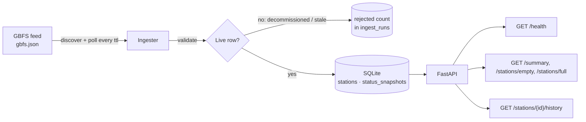

# City Pulse


**Live bike-share availability for any city, built on the open [GBFS](https://gbfs.org) standard.**
City Pulse polls a bike-share system every minute, cleans and stores station snapshots, and serves
an API that answers questions like *"which stations are empty right now?"* and *"how does this
station's availability change through the day?"*

It works with ~1,000 public systems (Citi Bike, Divvy, Bay Wheels, BIXI, Santander Cycles, …):
the city is configuration, not code.

## Architecture



## Quickstart

```bash
python3 -m venv .venv && source .venv/bin/activate
pip install -e ".[dev]"

python -m city_pulse.ingest --once      # one poll (or omit --once to keep polling)
uvicorn city_pulse.api:app --reload     # API docs at http://localhost:8000/docs
pytest -q
```

Point it at another city:

```bash
CITY_PULSE_GBFS_URL=https://gbfs.lyft.com/gbfs/2.3/chi/gbfs.json python -m city_pulse.ingest --once
```

| Variable | Default | Meaning |
|---|---|---|
| `CITY_PULSE_GBFS_URL` | Citi Bike NYC | Any system's `gbfs.json` auto-discovery URL |
| `CITY_PULSE_DB` | `data/city_pulse.db` | SQLite path |
| `CITY_PULSE_MAX_REPORT_AGE_S` | 7 days | Older reports are treated as dead stations |
| `CITY_PULSE_STALE_AFTER_S` | 300 | `/health` returns 503 past this ingest age |

## Design decisions

- **Idempotent ingestion.** Snapshots are keyed on `(station_id, last_reported)`. Stations only
  report when something changes, so re-polling stores only real changes, and a crashed or retried
  run can never create duplicates.
- **Poll rate comes from the feed.** The ingester sleeps for the feed's own `ttl` instead of a
  hardcoded interval, with a floor so a misconfigured feed can't hammer the publisher.
- **Data quality at the boundary.** Real feeds contain decommissioned stations reporting
  `last_reported: 86400` (a 1970 timestamp). Those rows are rejected and *counted* in
  `ingest_runs`, so data loss is visible rather than silent.
- **Every run is recorded.** `ingest_runs` stores status, row counts and errors. `/health` is
  built on it, so a monitor can alert when ingestion stalls even though the API is still up.
- **GBFS v1, v2 and v3** are all handled (nested vs flat feed lists, epoch vs RFC 3339 timestamps,
  localized names, bikes vs vehicles naming).

## Roadmap

- [x] **M1: Thin slice.** Ingest → validate → SQLite → API, 14 tests, CI on 3 Python versions
- [ ] **M2: Containers.** Dockerfile, docker-compose with Postgres, migrations
- [ ] **M3: Analytics.** dbt models (hourly availability, chronic empty/full hotspots, rebalancing
      demand), Dagster schedule, data-quality tests
- [ ] **M4: Cloud.** Terraform-provisioned deployment, CD from `main`, secrets management
- [ ] **M5: Observability.** Prometheus metrics, Grafana dashboard, alert on stale ingest, runbook
- [ ] **M6: Dashboard.** Live map of station availability
